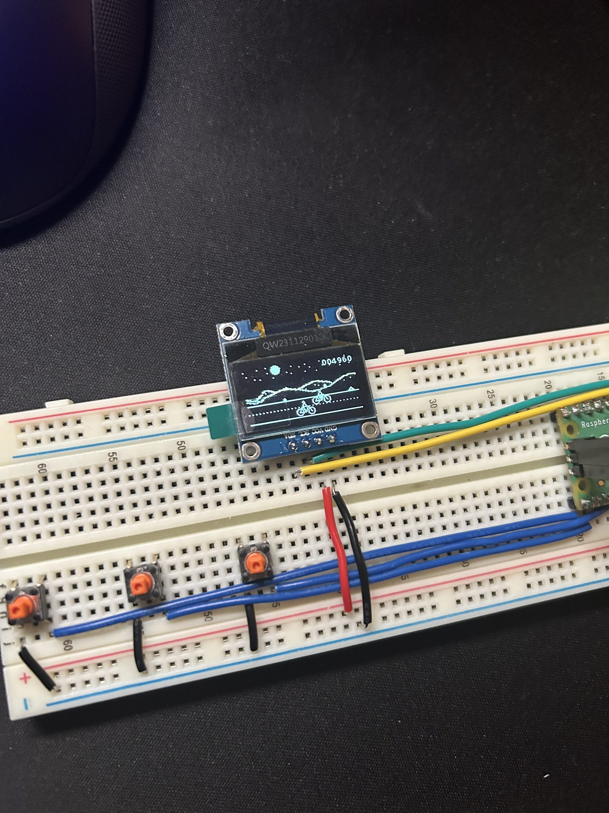

# Bike with friends

## A game about riding bikes with friends

### Running on RP2350 (Raspberry Pi Pico 2) with a SSD1306 128 x 64 display



Wrote this as a way for me to learn Rust & RP2040. Also part of a sharable [PCB project](https://dazgupta.com/journal/00020_biking_with_friends/) that I have been working on.

## Development

The build targets the RP2350 (Pico 2). Add the cross target once, then flash
and run over a debug probe (e.g. a Picoprobe) with `probe-rs`:

```bash
rustup target add thumbv8m.main-none-eabihf
cargo install probe-rs-tools --version 0.31.0 --locked   # 0.30.0 disconnects on multicore; 0.32.0 has a flashing regression
cargo run
```

`cargo run` flashes the board and streams `defmt` log output over RTT. See
`AGENTS.md` for wiring and alternative flashing methods (USB boot mode /
`picotool`).
## What is the game about?

I go on bike rides with friends across Scandinavia every year with my friends. This game was just me playing with that idea.

## TODO:
 - Add instructions for hooking up the buttons and displays.
 - Add how to play instructions.
 - Add start screen & play-pause?

